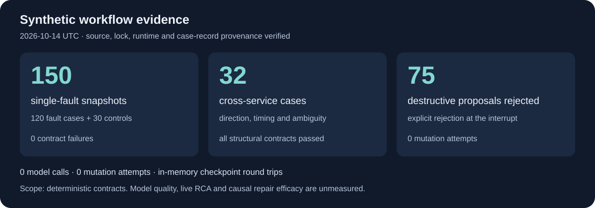
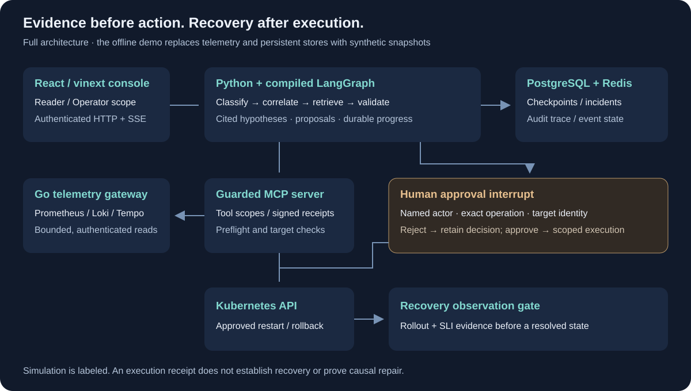

# OpsPilot — AI Production Incident Copilot

**An evidence-first incident workflow with durable checkpoints and human-approved remediation.**

Python · LangGraph · Go · MCP · PostgreSQL · Redis · React · Kubernetes

OpsPilot correlates metrics, logs, traces, dependencies, deployments and runbooks to investigate production incidents. Its engineering focus is the boundary between **a diagnosis, an authorized operation, and verified recovery**: a proposal cannot execute itself, and an execution receipt cannot mark an incident resolved.

[Run the offline demo](docs/demo.md) · [Inspect the evidence](docs/evidence.md) · [Architecture decisions](docs/architecture.md) · [Source tour](#source-tour)

## What makes it worth inspecting

| Engineering problem | Implemented mechanism | Where to inspect |
|---|---|---|
| Diagnosis must survive process loss | Compiled workflow checkpoints, retained incident state and audit events | [Workflow](services/orchestrator/incident_copilot/langgraph_workflow.py), [persistence](docs/project-reference.md#verified-persistence-behavior) |
| A proposal must not authorize a mutation | Human interrupt, named actor, scoped signed approval and target identity checks | [Approval boundary](docs/api-authorization.md), [MCP security](services/mcp-server/incident_mcp/security.py) |
| A successful API call may not fix an incident | Separate rollout/SLI recovery observation gate and read-only manual recheck | [Recovery implementation](services/orchestrator/incident_copilot/recovery_verification.py) |
| Dependencies may suggest several causes | Bounded directed investigation, observation windows, citations and advisory-only remote candidates | [Cross-service design](docs/architecture.md#bounded-cross-service-investigation) |
| A lost response must not replay a mutation | Read-only approval recovery and explicit streaming completion semantics | [Approval recovery](app/approval-recovery.ts), [stream contract](app/incident-stream.ts) |

## Evidence you can follow back to artifacts



The graphic uses two fresh **2026-10-14 UTC synthetic snapshot runs**: 150 single-fault cases (120 fault cases plus 30 controls), and 32 cross-service cases. The workflow retained 75 explicit rejections of destructive proposals and made zero execution attempts. Both runs made zero model calls. The rendering script verifies paired case-record hashes, source fingerprints, exact runtime/build lock hashes, the CPython 3.13.16 package provenance and declared release image/recipe hashes (the replay does not execute those images). Historical 2026-10-07 UTC artifacts remain separately retained.

These artifacts establish deterministic workflow contracts. They do not establish model accuracy, semantic faithfulness, live root-cause accuracy or causal repair efficacy. The [evidence guide](docs/evidence.md) separates these runs from historical PostgreSQL and Kubernetes experiments. The retained [ten-case demo result](docs/assets/demo-result.json), recorded during release preparation, provides a smaller reproducible entry point.

## Try it offline

The release demo was validated on **CPython 3.13.16 / macOS arm64**. Use the exact release interpreter; the service libraries retain Python 3.11+ bounds, but other interpreter/platform combinations have not been locally validated. From the repository root:

```bash
python3.13 -m venv .venv
source .venv/bin/activate
python -m pip install --require-hashes -r requirements-build.lock
python -m pip install --require-hashes -r requirements-demo.lock
python -m pip install --no-deps --no-build-isolation -e services/orchestrator -e services/mcp-server
python scripts/portfolio_demo.py
```

The [demo runtime lock](requirements-demo.lock) pins 51 platform-marked third-party distributions and their SHA256 artifacts; the separate [build lock](requirements-build.lock) pins installation/build tools. Both first-party services report version 0.2.0. The command runs eight fault families and two controls through the **real compiled LangGraph**, uses the BM25 index, rejects every destructive proposal, and checks in-memory checkpoint round trips. Execution requires no API key, Docker, database, cluster or network service. Expected summary: `cases: 10`, `passed: 10`, `model_calls: 0`, `execution_attempts: 0`. The current output includes exact runtime and lock provenance. [Understand each result](docs/demo.md).

The fuller console and service setup is in the [project reference](docs/project-reference.md#run-the-console). The lightweight stack uses deterministic fixtures behind the actual orchestrator → MCP → Go gateway path; fault-lab overrides add live observability. Production identity integration remains unfinished: the development console uses scoped Reader/Operator credentials rather than per-user SSO.

Checkpoint modes are separate: without `DATABASE_URL`, the API uses in-memory checkpoints and incident storage; the offline ten-case demo and 150/32 synthetic suites do not prove PostgreSQL durability. A configured PostgreSQL path uses `AsyncPostgresSaver` and durable incident/approval records. The retained 27 PostgreSQL checks and 39-check Compose experiment exercise that separate path; they are not memory-demo results.

A [historical actual-model smoke](evals/results/diagnosis_smoke_20261002T220247Z.json) used synthetic telemetry, the configured model and an in-memory graph on 2026-10-02 UTC. It stopped at `waiting_approval` without a production action. This is distinct from the zero-model deterministic tests, and does not establish current model quality, PostgreSQL recovery or live telemetry diagnosis. Running the offline demo makes no model request.

## Architecture and action boundary



Read tools are bounded and authenticated. Retrieved content remains untrusted. A destructive proposal retains its exact target and pauses at a human interrupt; execution rechecks authorization and target identity. Recovery is observed separately before `resolved`. The offline demo replaces telemetry and persistent stores with snapshots and in-memory checkpoints; it does not exercise the full diagram.

## Source tour

- [Orchestrator](services/orchestrator/incident_copilot): state machine, evidence, approvals, persistence, recovery and HTTP/SSE boundary.
- [MCP server](services/mcp-server/incident_mcp): tool scopes, approval receipts, knowledge retrieval and Kubernetes operations.
- [Go telemetry gateway](services/telemetry-gateway/internal/gateway): bounded observability adapters and service/deployment discovery.
- [Console](app/IncidentConsole.tsx): evidence review, proposals, scoped decisions and read-only response recovery.
- [Evaluation runners](evals/README.md): synthetic workflow, retrieval, cross-service and separately credentialed model evaluation.
- [Fault lab](fault-lab/README.md) and [Kubernetes experiments](deploy/kubernetes/README.md): owned fault injection, current versus historical acceptance and cleanup contracts.

## Verification and release status

The [release validation record](docs/release-verification-2026-10-13.md) distinguishes fresh checks and real dependency acceptance from historical experiments. The [earlier portfolio validation](docs/portfolio-verification-2026-10-13.md), [verification history](docs/verification.md), [completion audit](docs/completion-audit.md), and [project reference](docs/project-reference.md) preserve the deeper engineering record and its limits.

Release preparation on 2026-10-14 UTC recorded 1848 backend tests plus 108 subtests, 213 frontend tests and 39 real Compose checks against the exact patched images. The separate [publication-copy recheck](docs/publication.md#publication-copy-recheck) passed 1821 backend checks plus 108 subtests, with 27 PostgreSQL checks explicitly skipped, and all 213 frontend tests; it did not rerun Compose or Kubernetes. The release uses exact Node/Python/Go locks, hash-verified artifacts and frozen container recipes. The [security record](docs/dependency-security.md) retains the unfixed braces build advisory and scoped image findings. Two owned Kubernetes attempts failed at rollout because Docker storage filled; no current Kubernetes fault check passed, and the all-eight matrix is unverified. Production SSO, model faithfulness and approved repair efficacy remain outside the verified scope.

First-party source is [MIT licensed](LICENSE), with [third-party notices](THIRD_PARTY_NOTICES.md). This is an explicitly authorized **source-only preview**, not a production-ready or binary/container release. See the [publication provenance and limits](docs/publication.md), [per-file hash manifest](PUBLICATION-MANIFEST.json), [release checklist](docs/release-checklist.md), [contribution instructions](CONTRIBUTING.md) and [security policy](SECURITY.md). The documented Kubernetes and security limitations remain; source publication does not turn them into passed gates.
